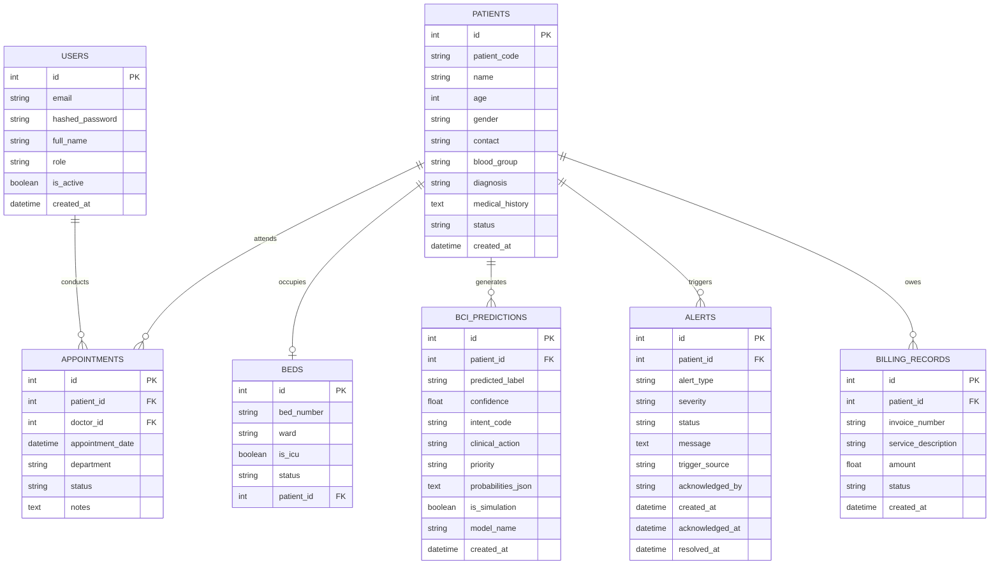

# NeuroCare BCI - Database Architecture & Schema

## 1. Overview

NeuroCare BCI utilizes a relational schema hosted on **MySQL 8.0** (`neurocare_bci` database). In local or constrained testing environments without a running MySQL instance, the application automatically falls back to an embedded SQLite database (`neurocare.db`), ensuring zero downtime.

Database connection management, session pooling, and object relational mapping (ORM) are implemented using **SQLAlchemy 2.0**.

---

## 2. Entity Relationship Overview

---

## 3. Seeded Accounts & Master Data

The application automatically provisions demonstration records via `backend/app/db/init_db.py`:

* **Clinical Staff Accounts**:
  - `admin@neurocare.hospital` / `admin123` (Role: Admin)
  - `doctor@neurocare.hospital` / `doctor123` (Role: Doctor)
  - `nurse@neurocare.hospital` / `nurse123` (Role: Nurse)
* **Hospital Wards & Beds**:
  - `Neuro-ICU`: Beds `ICU-01`, `ICU-02`, `ICU-03`, `ICU-04`
  - `Neurology Ward`: Beds `NW-101`, `NW-102`, `NW-103`, `NW-104`
  - `Rehabilitation Ward`: Beds `REH-201`, `REH-202`, `REH-203`, `REH-204`
* **Sample Inpatients**:
  - `Alexander Wright` (`NC-2026-001`, Bed: NW-101) - Post-Stroke Rehabilitation
  - `Beatrice Chen` (`NC-2026-002`, Bed: ICU-01) - ALS Assistive BCI Candidate
  - `Marcus Vance` (`NC-2026-003`, Bed: NW-102) - TBI Motor Dysfunction
  - `Diana Morales` (`NC-2026-004`, Bed: REH-201) - C5 Tetraplegia Assistive Communication
